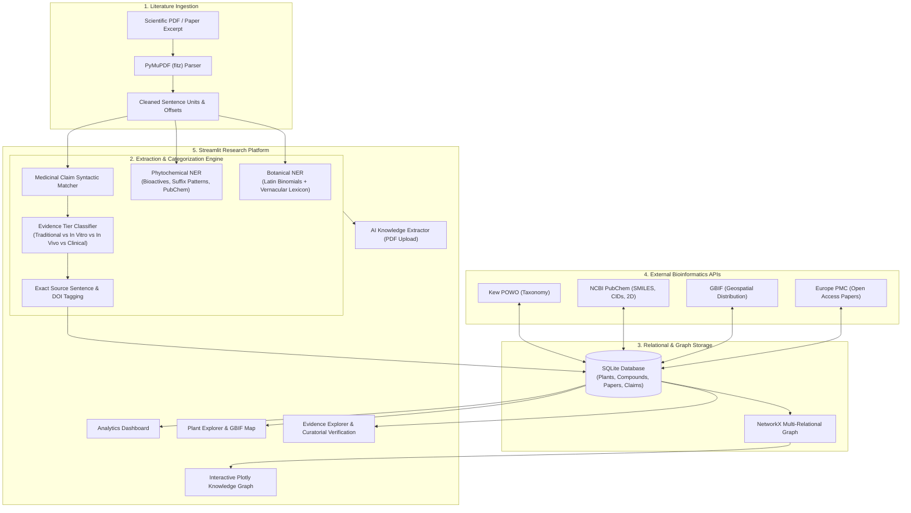

# 🌿 HERBINTEL: AI-Powered Traditional Medicine Intelligence Platform

[](https://herbintel.org)
[](https://www.python.org/)
[](https://streamlit.io/)
[](LICENSE)
[]()

> **HERBINTEL** is a reproducible bioinformatics research platform built for **EthnoHack 2026**. It bridges centuries of ethnobotanical folk medicine with modern phytochemistry, molecular pharmacology, and evidence-based clinical trials by parsing scientific literature, classifying claims into a strict 5-tier scientific evidence hierarchy, preserving exact verbatim source citations, and structuring connections inside a NetworkX knowledge graph.

---

## 🌟 Mission & Key Innovation

Traditional herbal medicine systems (Ayurveda, Traditional Chinese Medicine, Unani, Native American ethnobotany) hold profound empirical insights that led to revolutionary pharmaceutical drugs (such as **Artemisinin** for malaria, **Vinblastine** for leukemia, **Reserpine** for hypertension, and **Salicin** for Aspirin). However, translation is impeded by:
1. Conflation of folkloric claims with modern clinical efficacy.
2. Hallucinations and unsourced claims in general LLMs.
3. Fragmented silos between taxonomic databases, chemical libraries, and PubMed literature.

**HERBINTEL solves this by providing:**
* **Provenance-First Extraction:** Deterministic botanical binomial NER and phytochemical suffix recognizers preserve source context and require human review before claims are treated as verified.
* **Strict Evidence Hierarchy (5 Tiers):** Distinguishes *Traditional Ethnobotanical reports* from *In Vitro assays*, *In Vivo animal models*, and *Human Clinical Trials*.
* **Verbatim Sentence Provenance:** Every single claim preserves the exact unaltered source sentence, page number, section, and publication DOI.
* **Separation of NLP Confidence vs Scientific Strength:** Text extraction confidence represents natural language syntactic certainty—never biological efficacy.
* **Interactive Multi-Relational Knowledge Graph:** Built with **NetworkX** and **Plotly** to reveal polypharmacological mechanisms, multi-target botanical complexes, and shared secondary metabolites across distinct plant families.
* **100% Free & Open Core Workflow:** Operates entirely locally with zero paid API keys required.

---

## 🏛️ System Architecture



---

## 🔬 The 5-Tier Scientific Evidence Hierarchy

HERBINTEL organizes all assertions into a standardized hierarchy based on modern evidence-based medicine principles:

| Tier Code | Label | Typical Markers & Methods | UI Badge Color |
|---|---|---|---|
| **`CLINICAL`** | Clinical Trial / Human Study | Randomized controlled trials (RCT), double-blind, placebo cohorts, human volunteers, serum biomarkers | 🟢 Green |
| **`REVIEW_META`** | Systematic Review / Meta-Analysis | Systematic review, PRISMA protocol, meta-analysis of pooled trials | 🟣 Purple |
| **`IN_VIVO`** | In Vivo / Animal Model | Rodent models (Wistar rats, mice), dosage per kg (mg/kg), paw edema assays | 🔵 Dark Blue |
| **`IN_VITRO`** | In Vitro / Laboratory Assay | Microplate assays, IC50, MIC, DPPH antioxidant, cell lines (MCF-7, RAW 264.7) | 🔷 Light Blue |
| **`TRADITIONAL`**| Traditional / Ethnobotanical | Historical texts (Charaka Samhita, TCM, Ebers Papyrus), folkloric decoctions, healer interviews | 🟠 Amber |

---

## 💻 Platform Modules

### 1. 📊 Research Dashboard
* Real-time metrics: Total medicinal taxa, isolated phytocompounds, scientific papers, and claims.
* Interactive Plotly donut chart depicting evidence distribution across the 5 tiers.
* Status breakdown of human Curatorial Verifications (`Verified`, `Unverified`, `Disputed`). Benchmark records begin unverified.
* Featured discovery benchmarks (*Curcuma longa*, *Artemisia annua*, *Withania somnifera*, *Catharanthus roseus*).

### 2. 🌿 Plant Explorer
* Complete botanical profiles: Family, Genus, Kew POWO Taxon ID, GBIF Taxon Key, native range, and IUCN status.
* **GBIF Global Occurrence Map:** Interactive Plotly geographic scatter mapping showing specimen coordinates.
* **PubChem Phytochemical Profile:** Catalog of isolated secondary metabolites with 2D chemical structure diagrams, molecular formulas, and PubChem CIDs.
* Plant-specific claims matrix with exact verbatim sentence citations.

### 3. 🔬 AI Knowledge Extractor
* PDF literature parser powered by PyMuPDF (`fitz`).
* Preloaded benchmark papers included in `sample_data/` for instantaneous 1-click testing.
* Side-by-side extraction interface displaying:
  * Discovered plant taxa and chemical compounds.
  * Extracted medicinal-use claims with exact source sentences, page numbers, and sections.
  * Evidence tier assignment and NLP extraction confidence.
* Curatorial commit interface: Select and verify claims before committing them permanently to the SQLite database.

### 4. 🕸️ Knowledge Graph
* NetworkX-powered multi-relational graph rendered with Plotly 2D interactive spring layout.
* Color-coded nodes (Plants: Green, Compounds: Cyan, Conditions: Purple).
* Edges color-coded by evidence hierarchy.
* Filter by evidence tier or search by specific botanical or disease keywords.
* Network analytics: Degree centrality, Betweenness centrality bridge nodes, and modular clusters.
* Export capabilities: One-click export to **GraphML** (for Cytoscape/Gephi) and **JSON** (for D3.js).

### 5. 📑 Evidence Explorer & Claims Matrix
* Searchable and filterable matrix of all claims in the knowledge base.
* Interactive actions: Mark claims as `Verified`, `Disputed`, or `Unverified`.
* One-click dataset export to CSV.

### 6. 🌍 Biodiversity & Taxonomy Explorer
* Interactive multi-source botanical and phytochemical registry.
* Direct Kew POWO nomenclature verification with synonym resolution.
* NCBI PubChem 2D chemical structure rendering, SMILES, and InChIKey lookup.
* Europe PMC live literature search interface.

### 7. 📚 Research Methodology & Documentation
* Deep-dive documentation of the 5-Tier Scientific Evidence Hierarchy.
* Natural language extraction pipeline architecture and botanical NER heuristics.
* Ethical guidelines for preserving indigenous ethnobotanical intellectual property.

### 8. 🔎 AI Research Discovery Engine (Phase 6)
* **Multi-Modal Research Discovery:** Cross-search scientific literature by medicinal plant, phytochemical compound, or traditional therapeutic indication across both Europe PMC open-access papers and local database records.
* **Cross-Paper Analysis & Claim Clustering:** Aggregates findings from multiple selected publications, groups claims into therapeutic clusters, and categorizes study designs into standardized evidence tiers.
* **Scientific Contradiction & Divergence Engine:** Evaluates statistical efficacy across papers while strictly guarding against false contradictions between different experimental tiers (e.g., distinguishing pharmacodynamic in vitro receptor binding from human clinical oral bioavailability limitations).
* **6-Column Evidence Comparison Table:** Standardized evidence synthesis matrix (`Paper | Plant | Compound | Reported finding | Evidence type | Source`) with one-click direct DOI hyperlink navigation.
* **Expanded Research Knowledge Graph:** Extends the graph topology with `Paper` and `EvidenceTier` node types and 5 specialized biological edge semantics:
  1. `Plant` → `STUDIED_IN` → `Paper`
  2. `Paper` → `REPORTS_INDICATION` → `Medicinal use`
  3. `Plant` → `CONTAINS_PHYTOCHEMICAL` → `Compound`
  4. `Compound` → `EVALUATED_IN` → `Paper`
  5. `Paper` → `CLASSIFIED_AS_TIER` → `Evidence tier`
* **AI Research Summary Report:** Comprehensive 8-section evidence synthesis with strict sentence-level citation tracking (`[Author, Year; DOI]`), therapeutic consensus analysis, translational gaps, and zero-hallucination deterministic fallback.
* **Multi-Format Export Suite:** Instant export of research discovery sessions as:
  - **CSV:** Formatted 6-column evidence comparison table.
  - **Markdown:** Structured 8-section AI research synthesis report.
  - **JSON:** Complete bibliographical metadata, paper claims, and divergence audits.
  - **GraphML:** Multi-relational network topology ready for Cytoscape, Gephi, or NetworkX.

---

## 🚀 Quick Start Guide

### Prerequisites
* Python 3.10 or higher
* Git

### 1. Clone the Repository
```bash
git clone https://github.com/your-username/herbintel.git
cd herbintel
```

### 2. Install Dependencies
```bash
pip install -r requirements.txt
```

### 3. Run Automated Tests
Verify that all 50 automated tests pass (100% pass rate across all 8 modules):
```bash
python -m pytest tests/ -v
```

### 4. Launch the Streamlit Application
```bash
streamlit run app.py
```
Open your browser to `http://localhost:8501`.

---

## 🧪 Quick Test: AI Research Discovery Engine in 30 Seconds

1. Launch the application (`streamlit run app.py`).
2. Navigate to **🔎 AI Research Discovery** in the sidebar.
3. In the search bar, type `Curcuma longa` (or select from featured searches: *Curcuma longa*, *Withania somnifera*, *Artemisia annua*, or *Neuroprotective*).
4. Browse the unified literature results from Europe PMC and the local benchmark database.
5. Select multiple papers using the checkboxes and click **🔬 Analyze Selected Papers**.
6. Review the **Scientific Evidence Comparison Matrix** (6 standardized columns with live DOI links).
7. Inspect the **Divergent Findings & Contradiction Safeguards** panel to see nuanced evaluation across study tiers.
8. Explore the **Multi-Relational Research Knowledge Graph** showing Paper and EvidenceTier nodes.
9. Read the auto-synthesized **8-Section AI Research Summary** with direct citations.
10. Export findings using the 4 download buttons: **CSV Comparison**, **Markdown Summary**, **JSON Citations**, and **GraphML Network**.

---

## 🧪 Testing the PDF Extractor in 30 Seconds

1. Launch the application (`streamlit run app.py`).
2. Navigate to the **🔬 AI Knowledge Extractor** in the sidebar.
3. Select **🧪 Preloaded Sample Research Papers**.
4. Choose `sample_turmeric_curcumin_study.pdf` or `sample_ashwagandha_neuroprotection.pdf`.
5. Click **🚀 Run AI Extraction Pipeline**.
6. Inspect the extracted claims with exact source sentences and evidence tiers.
7. Click **💾 Commit Selected Claims to Knowledge Base** to link them into the Knowledge Graph!

---

## 🛡️ Scientific & Medical Disclaimer

> **IMPORTANT SCIENTIFIC NOTICE:**
> HERBINTEL is an academic research and bioinformatics intelligence platform developed for **EthnoHack 2026**.
> It is designed exclusively to organize scientific literature and facilitate ethnobotanical exploration.
> It does **NOT** provide medical advice, diagnosis, treatment, or pharmaceutical recommendations.
> Extracted text claims represent literature assertions and are labeled `Unverified` until validated by qualified human domain researchers.
> Text extraction confidence reflects NLP syntactic precision, **not** clinical efficacy.

---

## ⚖️ Dataset & API Licensing Attributions

* **NCBI PubChem:** Public domain chemical data provided by the National Center for Biotechnology Information (NCBI / NLM / NIH).
* **Europe PMC / PubMed:** Open Access literature repository managed by EMBL-EBI.
* **Kew Plants of the World Online (POWO):** Royal Botanic Gardens, Kew (Licensed under CC-BY 3.0 / Fair Academic Use).
* **GBIF:** Global Biodiversity Information Facility open occurrence data (Licensed under CC-BY / CC0).

### Traditional Knowledge Stewardship

HERBINTEL records knowledge-community attribution, consent/access status, benefit-sharing notes, and sensitivity level when curators submit claims. Sensitive or community-controlled knowledge must not be published or commercialized by default.

---

## 🏆 EthnoHack 2026 Submission Details
* **Project Name:** HERBINTEL (Traditional Medicine AI Intelligence Platform)
* **Category:** Ethnobotany, Bioinformatics, Natural Products Chemistry & Knowledge Graphs
* **Core Stack:** Python 3.10, Streamlit, NetworkX, Plotly, PyMuPDF, SQLite, Requests, Pytest.

"# HERBINTEL" 
